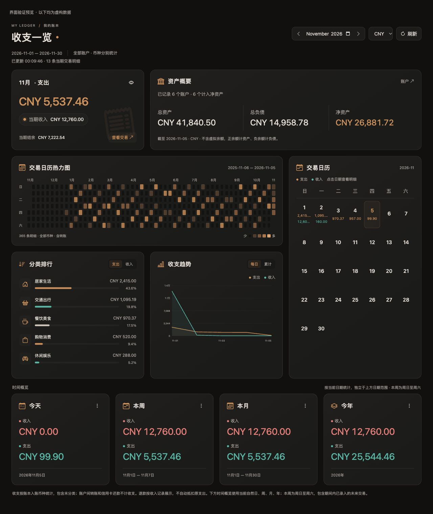

# Firefly III Custom Dashboard

适配 **Firefly III 6.7.9** 的定制首页，通过 Docker bind mount 替换首页 Blade 模板，并加载独立的 CSS、JavaScript。沿用 Firefly 的登录、导航和 API，无需额外配置个人访问令牌，也无需重新编译官方前端资源。

升级 Firefly 后，请先检查模板、公共资源和接口的兼容性。

## 首页截图

以下为使用**虚构账目**生成的界面预览；实际使用时显示当前登录用户的 Firefly 数据。

### 完整首页

完整页面包含月度收支、资产概要、年度交易热力图、交易日历、分类排行、收支趋势，以及最下方的今天、本周、本月、今年四张收支卡片：



## 功能

- 按月份或 Firefly 原有日期选择器查看收支、结余。
- 按币种分别查看账户资产、负债和净资产。
- 查看交易热力图、每日收支日历，点击日期打开明细。
- 在收入、支出分类排行之间切换，包含未分类交易。
- 查看每日或累计收支趋势。
- 查看今天、本周、本月、今年的收入与支出，使用卡片菜单在上方查看对应期间。
- 支持币种切换、金额隐藏及手机布局。

## 文件结构

```text
custom-dashboard/
├── LICENSE
├── README.md
├── index.blade.php
├── assets/
│   ├── dashboard.css
│   └── dashboard.js
└── docs/images/
    └── dashboard-overview-full.jpg
```

## Docker 挂载

在 Compose 项目的 `.env` 中设置 `DASHBOARD_DIR`，将示例值替换为宿主机上的仓库绝对路径：

```dotenv
DASHBOARD_DIR=/path/to/custom-dashboard
```

在现有 Compose 的 `app.volumes` 中追加以下两项，保留已有挂载。如果 Firefly III 服务名有别于 `app`，请在配置和命令中使用该服务名。

```yaml
services:
    app:
        volumes:
            - "${DASHBOARD_DIR:?Set DASHBOARD_DIR}/index.blade.php:/var/www/html/resources/views/index.blade.php:ro"
            - "${DASHBOARD_DIR:?Set DASHBOARD_DIR}/assets:/var/www/html/public/custom-dashboard:ro"
```

添加或移除挂载后，需要重新创建 `app` 容器。首页模板必须预先存在，且容器用户能够读取模板和静态资源。只覆盖首页文件，并将自定义静态资源挂载到单独目录。

如果遇到权限错误，请检查宿主机目录和文件的权限及 ACL，并确保容器用户可以遍历目录、读取模板和静态文件。

## 更新与回滚

修改首页后，同步递增模板中的 CSS、JavaScript 查询参数，避免浏览器使用旧资源。修改 Blade 后，在 Compose 项目目录清理视图缓存：

```sh
docker compose exec app php artisan view:clear
```

当 PHP 设置 `opcache.validate_timestamps=0` 时，还需要平滑重载 PHP-FPM，或在合适时机重启应用容器。

更新单文件 bind mount 时应保留原文件 inode；如果编辑器或 Git 操作替换了文件本身，需重新创建应用容器以重新绑定文件。模板和静态资源应保持同一版本。

回滚可恢复此前版本的三个源文件；恢复官方首页则移除上述两个自定义挂载，重新创建应用容器，并处理视图及 PHP 缓存。

## 统计口径

- 按 Firefly 配置的时区划分交易日期，完整读取分页并逐条处理拆分明细。
- 不同币种分别汇总；外币消费按账本保存的入账金额统计，明细另显示外币原金额。
- 自有账户转账及以转账记录的信用卡还款不计收入、支出。
- 退款按账本中的收入记录展示，不自动抵扣原支出。
- 资产概要统计计入净资产的账户，扣除虚拟余额；正余额计资产，负余额计负债。余额日期显示在卡片下方。
- 热力图使用全部币种的收支、转账明细笔数，显示截至上方期间末日与今天中较早日期的最近一年。
- 下方四张时间概览卡片按页面打开时的当前自然周期统计，独立于上方历史日期范围；本周为周日至周六，本月和今年使用完整自然月、自然年，包含已录入的未来交易。
- 接口失败、登录过期或分页不完整时显示错误，不用零金额代替失败结果。

## 验证记录

已完成 Blade 编译与 PHP 语法检查、金额精度与周期边界检查，以及使用虚构数据的桌面、手机交互检查。覆盖拆分交易、退款、转账、多币种、跨年周、闰年、空记录及接口失败场景。

预览数据和临时验证工具不包含在此仓库中。

## 许可证

本项目以 [MIT 许可证](LICENSE) 发布。Firefly III 上游项目使用 [AGPL-3.0](https://github.com/firefly-iii/firefly-iii/blob/v6.7.9/LICENSE)。
